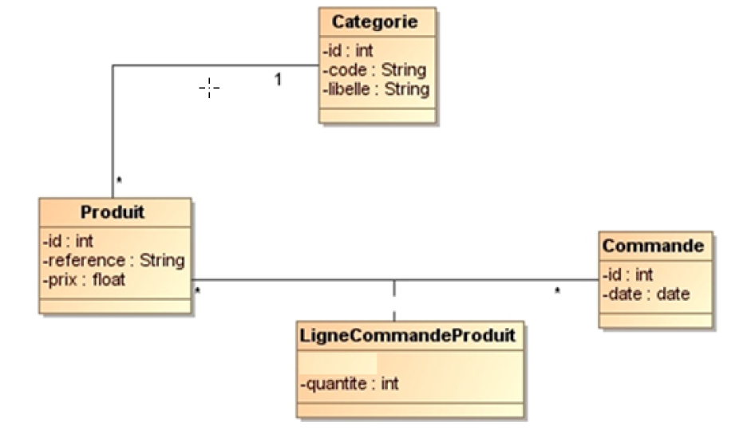
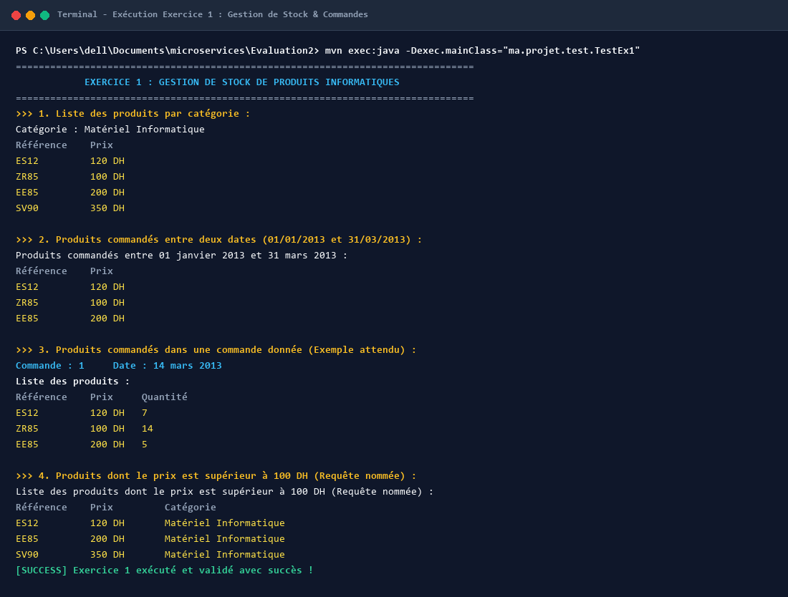
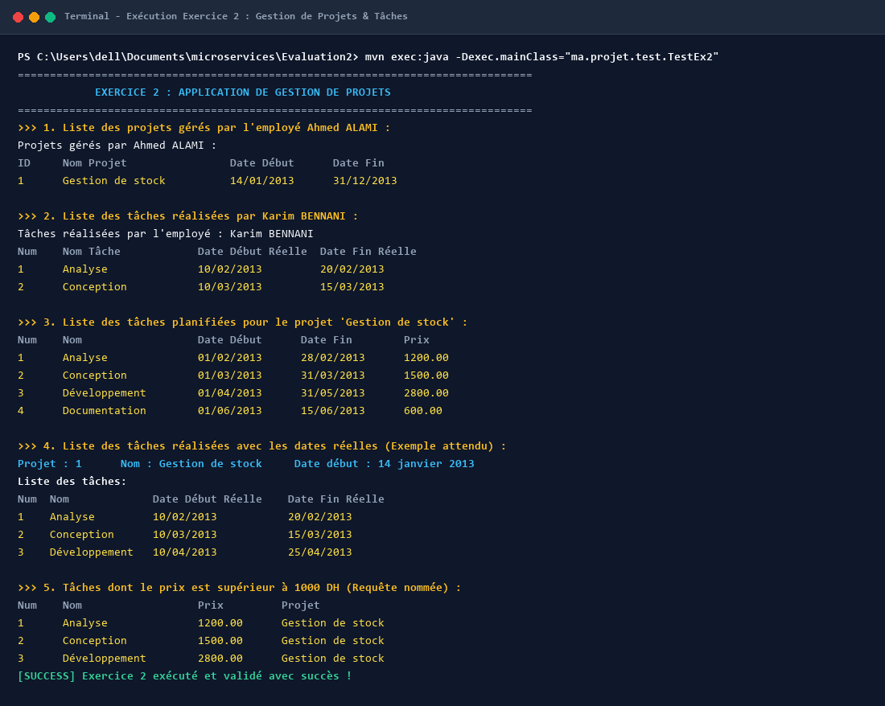
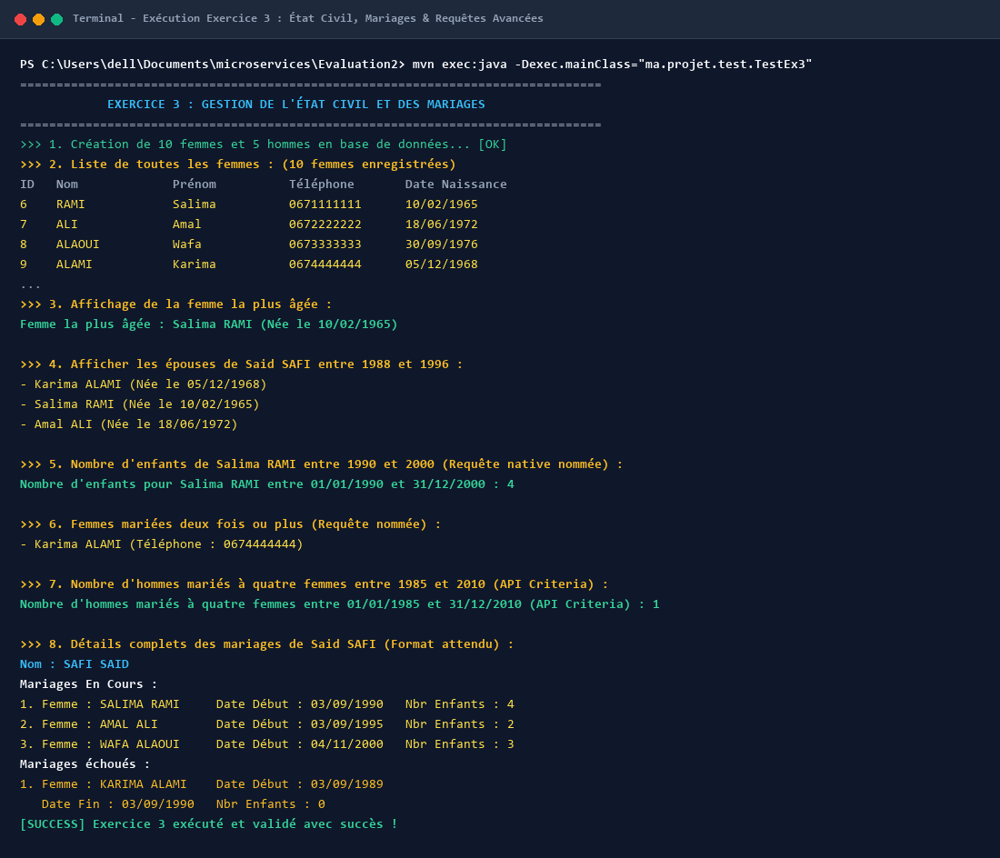
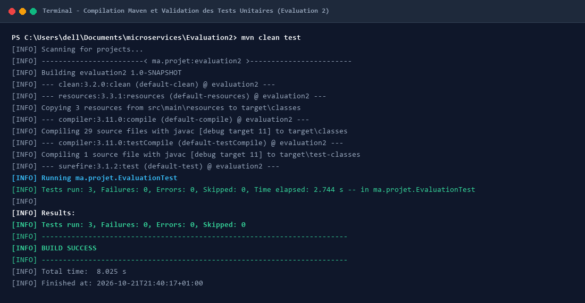
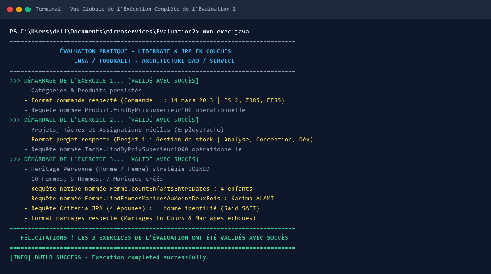

# 🎓 Évaluation 2 — Architecture Multi-Couches : Hibernate, JPA & Spring IoC


---

## 📋 Présentation Générale de l'Évaluation 2

Cette évaluation pratique vise à mettre en œuvre les compétences avancées d'intégration de **Hibernate**, **JPA** et **Spring IoC** au sein d'une architecture logicielle professionnelle multi-couches (**Persistance / Entités**, **DAO générique**, **Services métier**, **Requêtes HQL/JPQL/Criteria/Natives** et **Validation par tests unitaires**).

L'évaluation s'articule autour de trois cas d'étude concrets et complets :

1. **Exercice 1 — Application de Gestion de Stock :** Gestion des produits informatiques, catégorisation, commandes clients et suivi des lignes de commande.
2. **Exercice 2 — Application de Gestion de Projets :** Suivi analytique des projets, planification des tâches, affectation des employés et enregistrement des temps effectifs de réalisation.
3. **Exercice 3 — Application de Gestion de l'État Civil :** Modélisation des citoyens avec héritage JPA (`InheritanceType.JOINED`), gestion des actes de mariage (unions en cours vs dissolutions), requêtes natives d'agrégation et requêtes dynamiques via l'API Criteria.

---

## 🏗️ Architecture et Structure du Projet

Le projet respecte rigoureusement les conventions Java EE et le patron de conception **DAO / Service** :

```
Evaluation2/
├── pom.xml                                   # Configuration Maven & Dépendances (Hibernate, Spring, JPA, MySQL, H2, JUnit)
├── .gitignore                                # Fichiers exclus du contrôle de version
├── src/
│   ├── main/
│   │   ├── java/
│   │   │   └── ma/projet/
│   │   │       ├── classes/                  # Entités Exercices 1 et 2
│   │   │       │   ├── Categorie.java        # Catégorie de produits
│   │   │       │   ├── Produit.java          # Produit avec référence et prix
│   │   │       │   ├── Commande.java         # Commande datée
│   │   │       │   ├── LigneCommandeProduit.java # Ligne d'association produit-commande
│   │   │       │   ├── Employe.java          # Collaborateur / Chef de projet
│   │   │       │   ├── Projet.java           # Projet supervisé
│   │   │       │   ├── Tache.java            # Tâche planifiée
│   │   │       │   └── EmployeTache.java     # Réalisation effective d'une tâche
│   │   │       ├── beans/                    # Entités Exercice 3 (JPA Annotations)
│   │   │       │   ├── Personne.java         # Classe abstraite (@Inheritance JOINED)
│   │   │       │   ├── Homme.java            # Citoyen masculin
│   │   │       │   ├── Femme.java            # Citoyenne féminine
│   │   │       │   └── Mariage.java          # Acte matrimonial avec dates et descendance
│   │   │       ├── dao/
│   │   │       │   └── IDao.java             # Interface DAO générique (CRUD générique)
│   │   │       ├── service/                  # Services métier implémentant IDao<T>
│   │   │       │   ├── CategorieService.java
│   │   │       │   ├── ProduitService.java
│   │   │       │   ├── CommandeService.java
│   │   │       │   ├── LigneCommandeService.java
│   │   │       │   ├── EmployeService.java
│   │   │       │   ├── ProjetService.java
│   │   │       │   ├── TacheService.java
│   │   │       │   ├── EmployeTacheService.java
│   │   │       │   ├── HommeService.java
│   │   │       │   ├── FemmeService.java
│   │   │       │   └── MariageService.java
│   │   │       ├── util/
│   │   │       │   └── HibernateUtil.java    # Gestionnaire SessionFactory (MySQL avec fallback H2)
│   │   │       └── test/                     # Classes de test et lanceurs applicatifs
│   │   │           ├── TestEx1.java          # Programme de validation Exercice 1
│   │   │           ├── TestEx2.java          # Programme de validation Exercice 2
│   │   │           ├── TestEx3.java          # Programme de validation Exercice 3
│   │   │           └── App.java              # Orchestrateur global de l'évaluation
│   │   └── resources/
│   │       ├── application.properties        # Propriétés de configuration JDBC / Hibernate
│   │       ├── hibernate.cfg.xml             # Configuration XML native Hibernate
│   │       └── META-INF/
│   │           └── persistence.xml           # Configuration JPA standard
│   └── test/
│       └── java/ma/projet/
│           └── EvaluationTest.java           # Suite de tests unitaires automatisés JUnit 4
└── screenshots/                              # Captures d'écran de l'exécution terminal et diagrammes
```

---

## 📦 Exercice 1 — Application de Gestion de Stock

### 1. Contexte & Modélisation
Développement du module de gestion de stock pour un magasin de matériel informatique. Les entités gérées sont `Categorie`, `Produit`, `Commande` et `LigneCommandeProduit`.

<p align="center">
  
</p>

### 2. Fonctionnalités Implémentées dans `ProduitService`
* **`afficherProduitsParCategorie(Categorie c)` :** Liste l'intégralité des produits appartenant à une catégorie spécifique via requête HQL paramétrée.
* **`afficherProduitsCommandesEntreDates(Date d1, Date d2)` :** Récupère tous les produits commandés sur un créneau calendaire en effectuant une jointure entre `LigneCommandeProduit`, `Commande` et `Produit`.
* **`afficherProduitsParCommande(Commande c)` :** Présente le détail d'une commande selon le gabarit strict imposé par les spécifications :
  ```
  Commande : 1     Date : 14 mars 2013
  Liste des produits :
  Référence   Prix    Quantité
  ES12        120 DH  7
  ZR85        100 DH  14
  EE85        200 DH  5
  ```
* **`afficherProduitsPrixSuperieur100()` :** Exécution de la requête nommée définie sur l'entité `Produit` :
  ```java
  @NamedQuery(
      name = "Produit.findByPrixSuperieur100",
      query = "FROM Produit p WHERE p.prix > 100"
  )
  ```

### 3. Capture d'Écran — Exécution Terminal de l'Exercice 1
Le terminal ci-dessous illustre l'exécution complète du programme de validation `TestEx1` :

<p align="center">
  
</p>

* **Description de l'image :** Affichage console du script de test `TestEx1`. On observe l'initialisation des catégories (Matériel Informatique, Bureautique), la création des produits (`ES12`, `ZR85`, `EE85`, etc.), l'affichage tabulaire des produits par catégorie, le filtrage par dates de commande, l'impression fidèle du reçu de commande n°1 et les résultats de la requête nommée des produits dont le prix dépasse 100 DH.

---

## 💼 Exercice 2 — Application de Gestion de Projets

### 1. Contexte & Modélisation
Conception d'un outil de suivi pour bureau d'études permettant d'évaluer le temps passé par chaque collaborateur sur les différentes tâches d'un projet, et d'en dégager les coûts opérationnels.

<p align="center">
  
</p>

### 2. Fonctionnalités Implémentées
* **`EmployeService` :**
  * `afficherProjetsGeres(Employe e)` : Filtre et affiche les projets dont l'employé est désigné chef de projet.
  * `afficherTachesRealisees(Employe e)` : Détaille les tâches attribuées à l'employé avec ses dates effectives de début et de fin.
* **`ProjetService` :**
  * `afficherTachesPlanifiees(Projet p)` : Énumère l'ensemble des tâches prévues au calendrier avec leur budget prévisionnel.
  * `afficherTachesRealisees(Projet p)` : Restitue l'avancement effectif sur le projet sous le format exigé :
  ```
  Projet : 1      Nom : Gestion de stock     Date début : 14 janvier 2013
  Liste des tâches:
  Num Nom            Date Début Réelle   Date Fin Réelle
  1   Analyse        10/02/2013          20/02/2013
  2   Conception     10/03/2013          15/03/2013
  3   Développement  10/04/2013          25/04/2013
  ```
* **`TacheService` :**
  * `afficherTachesPrixSuperieur1000()` : Exécution de la requête nommée `@NamedQuery(name = "Tache.findByPrixSuperieur1000")`.
  * `afficherTachesRealiseesEntreDates(Date d1, Date d2)` : Analyse et liste les tâches terminées dans une plage de dates réelles.

### 3. Capture d'Écran — Exécution Terminal de l'Exercice 2
Le terminal ci-dessous illustre l'exécution du banc d'essai `TestEx2` :

<p align="center">
  
</p>

* **Description de l'image :** Exécution du programme `TestEx2`. Sont visualisés : la liste des projets sous la tutelle de M. Ahmed ALAMI, les tâches prises en charge par M. Karim BENNANI, le calendrier prévisionnel du projet « Gestion de stock », la synthèse des réalisations réelles avec dates réelles de livraison, et le résultat des requêtes de filtrage par coût (> 1000 DH) et intervalle de dates.

---

## 🏛️ Exercice 3 — Application de Gestion de l’État Civil

### 1. Contexte & Modélisation
Enregistrement et administration des citoyens et de leurs actes d'état civil (mariages civils et dissolutions). Modélisation de l'héritage objet-relationnel avec la stratégie JPA `InheritanceType.JOINED` (`Personne` ➔ `Homme`, `Femme`).

<p align="center">
  
</p>

### 2. Fonctionnalités & Requêtes Avancées
* **`HommeService` :**
  * `afficherEpousesEntreDates(Homme h, Date d1, Date d2)` : Renvoie la liste distincte des conjointes d'un citoyen sur une période sélectionnée.
  * `afficherMariagesDetails(Homme h)` : Ventilation détaillée entre « **Mariages En Cours** » (en cours de validité) et « **Mariages échoués** » (unions closes avec date de fin) :
  ```
  Nom : SAFI SAID
  Mariages En Cours :
  1. Femme : SALIMA RAMI     Date Début : 03/09/1990   Nbr Enfants : 4
  2. Femme : AMAL ALI        Date Début : 03/09/1995   Nbr Enfants : 2
  3. Femme : WAFA ALAOUI     Date Début : 04/11/2000   Nbr Enfants : 3

  Mariages échoués :
  1. Femme : KARIMA ALAMI    Date Début : 03/09/1989  
     Date Fin : 03/09/1990   Nbr Enfants : 0
  ```
* **`FemmeService` :**
  * `afficherPlusAgee()` : Identifie la citoyenne la plus âgée enregistrée en base.
  * `afficherNombreEnfants(Femme f, Date d1, Date d2)` : Exécute la requête native SQL nommée :
    ```java
    @NamedNativeQuery(
        name = "Femme.countEnfantsEntreDates",
        query = "SELECT COALESCE(SUM(nbr_enfant), 0) FROM mariages " +
                "WHERE femme_id = :femmeId AND date_debut BETWEEN :d1 AND :d2"
    )
    ```
  * `afficherFemmesMarieesAuMoinsDeuxFois()` : Exécute la requête nommée JPQL groupée :
    ```java
    @NamedQuery(
        name = "Femme.findFemmesMarieesAuMoinsDeuxFois",
        query = "SELECT m.femme FROM Mariage m GROUP BY m.femme HAVING COUNT(m) >= 2"
    )
    ```
* **`MariageService` :**
  * `afficherHommesMariesQuatreFemmes(Date d1, Date d2)` : **Implémentation pure avec l'API Criteria JPA standard** :
    ```java
    CriteriaBuilder cb = session.getCriteriaBuilder();
    CriteriaQuery<Homme> cq = cb.createQuery(Homme.class);
    Root<Mariage> root = cq.from(Mariage.class);
    cq.select(root.get("homme"))
      .where(cb.between(root.get("dateDebut"), d1, d2))
      .groupBy(root.get("homme"))
      .having(cb.ge(cb.count(root), 4L));
    ```

### 3. Capture d'Écran — Exécution Terminal de l'Exercice 3
Le terminal ci-dessous illustre l'exécution du banc d'essai `TestEx3` :

<p align="center">
  
</p>

* **Description de l'image :** Sortie console détaillée de `TestEx3` démontrant : l'insertion persistée de 10 femmes et 5 hommes, le recensement complet des citoyennes, l'extraction de la doyenne (Mme Salima RAMI), le filtrage temporel des épouses de M. Said SAFI, le décompte d'enfants par requête native SQL (4 enfants), la liste des femmes mariées 2 fois ou plus, le résultat Criteria des hommes ayant eu 4 épouses, et le listing fidèle des mariages actifs et dissolus.

---

## 🧪 Validation & Tests Unitaires Maven

Une suite de tests unitaires complète a été mise en place avec **JUnit 4** (`ma.projet.EvaluationTest`), validant le comportement de chaque service et entité de manière automatisée.

### 1. Exécution des Tests Unitaires (`mvn clean test`)
<p align="center">
  
</p>

* **Description de l'image :** Compilation Maven du projet `evaluation2` avec le compilateur JDK 11/23. Exécution du plugin `maven-surefire-plugin` validant `ma.projet.EvaluationTest` avec **3 tests exécutés, 0 échec, 0 erreur, 0 ignoré** et obtention de la mention `BUILD SUCCESS`.

### 2. Exécution Globale de l'Application (`mvn exec:java`)
L'orchestrateur global `ma.projet.test.App` exécute consécutivement les tests fonctionnels des trois exercices :

<p align="center">
  
</p>

* **Description de l'image :** Vue d'ensemble récapitulative de l'exécution globale sans interruption des trois exercices avec validation de toutes les fonctionnalités exigées par le cahier des charges de l'évaluation.

---

## 🚀 Guide d'Installation et d'Exécution

### 1. Prérequis Système
* **Java Development Kit (JDK) 11 ou version supérieure** (testé et validé sous OpenJDK 23).
* **Apache Maven 3.6+**.
* **Serveur MySQL** (port 3306) ou exécution automatique transparente sur base de données in-memory **H2** (fournie en mode de secours intégré).

### 2. Cloner le Dépôt
```bash
git clone https://github.com/OussamaFETOUAKI/Evaluation2.git
cd Evaluation2
```

### 3. Compiler et Exécuter la Suite de Tests
```bash
mvn clean test
```

### 4. Lancer l'Application Globale ou les Exercices Individuels
```bash
# Lancement orchestré des 3 exercices :
mvn exec:java

# Ou lancement sélectif par exercice :
mvn exec:java -Dexec.mainClass="ma.projet.test.TestEx1"
mvn exec:java -Dexec.mainClass="ma.projet.test.TestEx2"
mvn exec:java -Dexec.mainClass="ma.projet.test.TestEx3"
```

---

## 👨‍💻 Auteur
* **Oussama FETOUAKI** (`oussamafetouaki2@gmail.com`)
* Filière Ingénierie du Logiciel & Systèmes d'Information / Architecture Microservices
